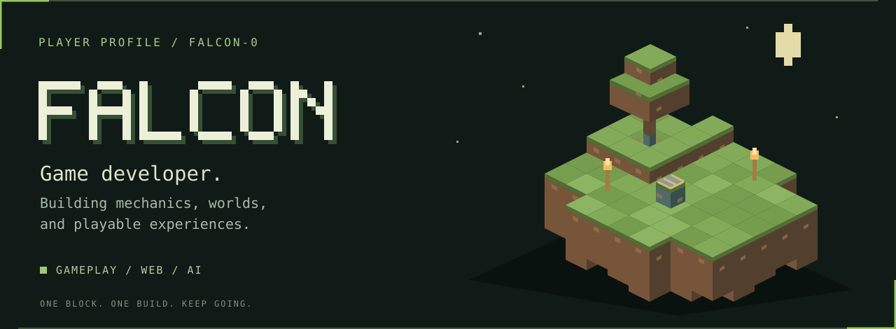
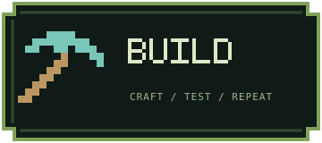
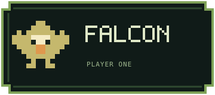

  

  <strong>Game developer building mechanics, worlds, and playable experiences.</strong> 
  Exploring the space between games, the web, and AI.

  
  &nbsp;
  

### Current quest

**[Infinite Stadium](https://github.com/falcon-0/infinite-stadium)**  
An Azure AI football companion that turns synthetic match data into evidence-backed answers. Ask about a moment while the replay keeps moving.

[Enter the stadium](https://infinite-stadium-lime.vercel.app/) · [Explore the source](https://github.com/falcon-0/infinite-stadium)

### Project inventory

| Build | What you'll find |
| :--- | :--- |
| [Infinite Stadium](https://github.com/falcon-0/infinite-stadium) | Synthetic football intelligence, match replays, and Azure AI explanations. |
| [Dice Night Royale](https://github.com/falcon-0/dice-night-royale) | A real-time social multiplayer game built around push-your-luck decisions. |
| [FALCON X](https://github.com/falcon-0/falcon-x) | An interactive game studio storefront. |

### In the crafting table

`JavaScript` · `HTML & CSS` · `Azure AI` · `Game development`

Original voxel artwork and pixel stickers made for this profile.
